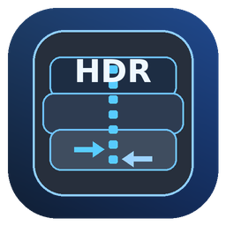

<div align="center">



# HDR Studio

**Knight Online `.hdr` / `.src` Archive Pack & Unpack Tool**

[](https://github.com/akazaio/HDR_Class)
[](https://go.dev)
[]()
[]()

---

</div>

## 📖 Overview

**HDR Studio** is a native Windows GUI application for Knight Online private server developers. It lets you **pack** folders into `.hdr` + `.src` archive pairs and **unpack** them back — with a clean dark-themed interface, drag & drop support, and bilingual (Turkish / English) UI.

## ✨ Features

- 📦 **Pack** folders into `.hdr` + `.src` archive pairs
- 📂 **Unpack** matching archive pairs back to files
- 🌐 **Turkish / English** bilingual interface
- 🖥️ **Native Windows GUI** — no console window, no dependencies
- 🎯 **Drag & Drop** support for quick operations
- ⚡ **Background worker** for responsive long operations
- 🔒 **Safety checks** — archive bounds validation & path traversal protection
- 💾 **Optional backup** and overwrite behavior
- 🎨 **Dark themed** custom controls with double-buffered progress bar
- 🏗️ **x64 and x86** builds included

## 📥 Quick Download (Executables Only)

> **Just want the tool? Download the exe directly:**

| File | Architecture | Size | SHA-256 |
|------|:---:|---:|---------|
| **[`HDRStudio_x64.exe`](dist/HDRStudio_x64.exe)** | x64 | ~1.9 MB | `602503b7...` |
| **[`HDRStudio_x86.exe`](dist/HDRStudio_x86.exe)** | x86 | ~1.7 MB | `e3960eff...` |

Click the filename → then click **"Download raw file"** button on the next page.

> Full SHA-256 checksums are available in [`dist/SHA256SUMS.txt`](dist/SHA256SUMS.txt)

## 🚀 Getting Started

1. Download the exe matching your system (x64 recommended)
2. Run it — no installation needed
3. **To Unpack:** Select the `.hdr` file → choose output folder → Extract
4. **To Pack:** Select source folder → choose output path → Pack

## 📂 What are HDR / SRC Files?

Knight Online uses `.hdr` + `.src` archive pairs to bundle game resources (textures, models, UI data, configuration files). The `.hdr` file contains the directory/header information, while `.src` holds the actual file data. HDR Studio lets you inspect, extract, modify, and repackage these archives.

## 🏗️ Repository Layout

```
.github/workflows/build.yml   ─  CI/CD build & release workflow
assets/                        ─  Application artwork (icons)
dist/                          ─  Pre-built executables
  ├─ HDRStudio_x64.exe         ─  64-bit Windows build
  ├─ HDRStudio_x86.exe         ─  32-bit Windows build
  └─ SHA256SUMS.txt            ─  Integrity checksums
source/                        ─  Application source code
  ├─ main.go                   ─  Complete Go source
  └─ hdrstudio.ico             ─  Multi-size application icon
tools/                         ─  Build utilities
  ├─ embed_pe_resources.py     ─  PE icon/version/manifest builder
  └─ generate_icon.py          ─  Icon generator script
build.ps1                      ─  Windows PowerShell build script
build.sh                       ─  Linux / WSL build script
sign_release.ps1               ─  Authenticode signing helper
go.mod                         ─  Go module definition
CODE_SIGNING.md                ─  Production signing documentation
```

## 🔨 Building from Source

### GitHub Actions (Recommended)

Push to GitHub — the workflow builds x64 and x86 automatically. Tagging a release (e.g. `v1.0.3`) prepares signed release artifacts.

### Windows PowerShell

**Requirements:** Go 1.23+, Python 3, `objcopy` or `llvm-objcopy`

```powershell
./build.ps1
```

### Linux / WSL

```bash
./build.sh
```

Output is written to `dist/`.

## ⚠️ Notes

- **Windows SmartScreen:** Unsigned builds may trigger a reputation warning. See [`CODE_SIGNING.md`](CODE_SIGNING.md) for production signing setup.
- **Intended Use:** This tool is for private server development and educational purposes.

---

<div align="center">

**Made by [AKAZA](https://github.com/akazaio)** · ⭐ Star this repo if you find it useful!

</div>
